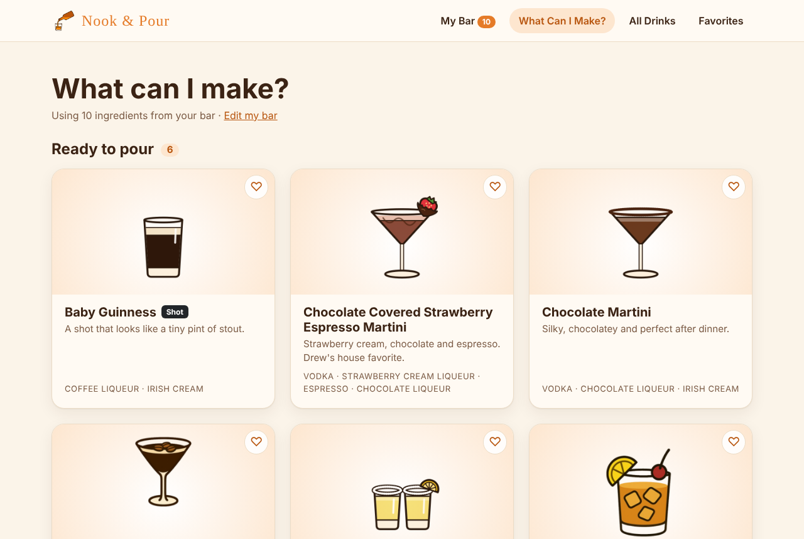

<div align="center">
  

# Nook & Pour
 
**Tell it what's in your cabinet. It tells you what to pour.**
 
[**Live demo → nook-pour.vercel.app**](https://nook-pour.vercel.app)
 
[](https://opensource.org/licenses/MIT)


 
</div>


 
## About the project
 
Nook & Pour is a full-stack cocktail app. Mark off the spirits, mixers and garnishes you have at home, and it shows you:
 
- **Ready to pour:** every drink you can make right now
- **Almost there:** drinks you're one or two ingredients away from, and exactly what's missing
- **Best next buy:** the bottle that would unlock the most new drinks

It also includes:
 
- **50+ recipes** (cocktails and shots), each with an illustration, measurements, glassware and step-by-step instructions
- **75+ ingredients** grouped into spirits, liqueurs & vermouths, mixers & juices, and garnishes
- **Search and filters** by drink name, ingredient, or cocktail vs. shot
- **Favorites**, plus a bar that's remembered between visits
- **Shareable recipe pages** (e.g. `/drinks/old-fashioned`)
- A responsive layout that works on phone, tablet and desktop

Garnishes and rims are listed in each recipe but never stop a drink from matching. Nobody should miss out on a Margarita because they're out of salt.
 
## Tech stack
 
| Layer      | Tech |
| ---------- | ---- |
| Frontend   | React, React Router, React Bootstrap, Vite |
| Backend    | Python, Flask, REST API, gunicorn |
| Database   | PostgreSQL (psycopg) with a hand-written SQL schema |
| Testing    | pytest (runs on in-memory SQLite, so no Postgres needed) |
| Deployment | Vercel (frontend) · Render (API + PostgreSQL) |
 
## How it works
 
```
Browser ──▶ Vercel (React app)
               │  /api/* is forwarded (client/vercel.json)
               ▼
            Render (Flask API) ──▶ Render PostgreSQL
```
 
The React app always calls `/api/...`. Locally, Vite proxies those calls to Flask. In production, Vercel forwards them to the Render API, so the front-end code is identical in both environments and there's no CORS setup to manage.
 
Matching happens on the server: `POST /api/match` takes the ingredients you have and returns what you can make, what you're close to, and which single ingredient would unlock the most drinks.
 
## Getting started
 
### Prerequisites
 
- Node.js
- Python 3
- PostgreSQL 
### 1. Install
 
```bash
git clone git@github.com:Drew-Andersen/Nook-Pour.git
cd Nook-Pour
 
python3 -m venv server/venv
source server/venv/bin/activate         
npm run setup                           
```
 
### 2. Configure the database
 
```bash
createdb nook_pour
cp server/.env.example server/.env      
```
 
`server/.env` accepts either a single `DATABASE_URL` or the separate `POSTGRESQL_*` values.

 
### 3. Run it
 
```bash
npm run seed
npm run dev
```
 
- React app: http://localhost:5173
- Flask API: http://localhost:5000

On first start, the API creates its tables and loads all the recipes automatically.
 
## Project structure
 
```
client/                 React app (Vite)
  public/images/        Drink illustrations
  src/pages/            Home, My Bar, What Can I Make?, All Drinks, Drink detail, Favorites, 404
  src/components/       DrinkCard, DrinkModal, Recipe, Header, ...
  src/hooks/            useApi, useLocalStorage, useBar
  src/lib/api.js        All API calls in one place
  vercel.json           Forwards /api to Render, serves index.html for app routes
server/
  app.py                Flask app and routes
  catalog.py            Queries and the matching logic
  db.py                 PostgreSQL/SQLite connection wrapper
  schema.sql            Table definitions
  seed_data.py          The recipe catalog: add drinks here
  seed.py               Resets and reloads the database
  tests/                API tests
```
 
### Adding a drink
 
1. Add an entry to `DRINKS` in `server/seed_data.py`, and add any new ingredients to `INGREDIENTS`.
2. Add a 408×612 PNG illustration to `client/public/images/` and point the drink's `image` at it.
3. Run `npm test`. It fails if a drink uses an unknown ingredient or is missing its image.
4. Run `npm run seed`.
 
## Roadmap
 
### MVP
 
- [x] Ingredient selection, remembered between visits
- [x] Matching with "almost there" and "best next buy"
- [x] PostgreSQL database
- [x] Search, filters, recipe pages, favorites, 404 page
- [x] Loading and error states
- [x] Illustrations for every drink
- [x] Deploy (Vercel + Render)

### Future development
  
- [ ] **User accounts / log in:** save each user's bar and favorites to their account so they
  sync everywhere: computer or tablet at home, phone on the road or at the liquor store.
  (Today they're stored in the browser's localStorage, so they stay on one device.)
- [ ] **AI agent:** an assistant built into Nook & Pour.
- [ ] **Apple App Store app:** release Nook & Pour as an iOS app
- [ ] Submit your own recipes

## License
 
MIT. See [**LICENSE**](/LICENSE).
 
## Contact
 
**Drew Andersen** · [GitHub](https://github.com/Drew-Andersen) · [Email](mailto:andrewtandersen@gmail.com) · [Live demo](https://nook-pour.vercel.app)
 
*Please drink responsibly.*